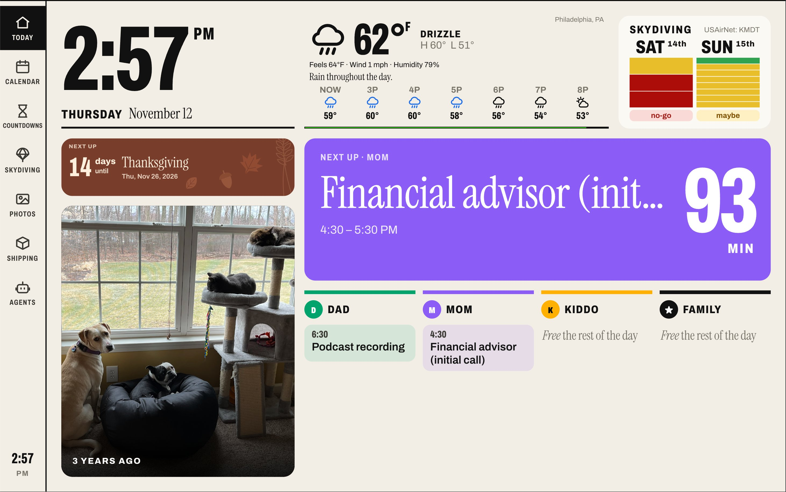
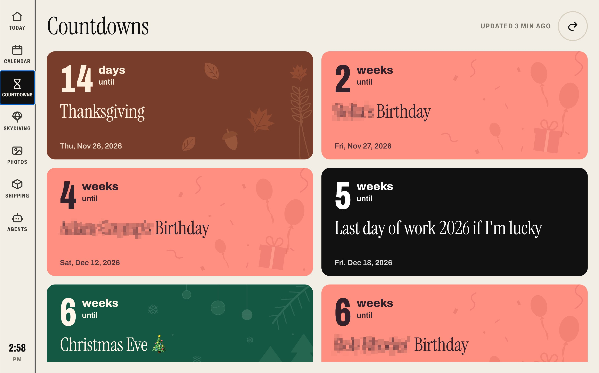
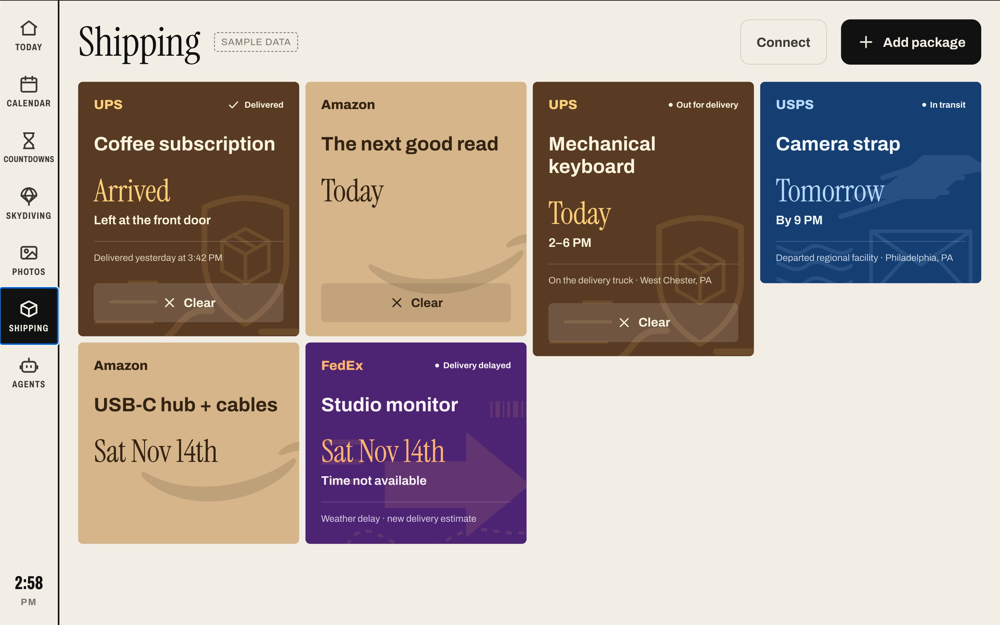

# Dashy

Dashy is a non-fork clone of [Wes Bos’s photo frame dashboard](https://github.com/wesbos/photo-frame-dashboard). I’m sharing the features I built for my own frame, like calendar countdowns, package tracking, and weekend skydiving forecasts, in case they inspire something you’d like to build for yours.

## Screenshots

## Daytime screensaver

When the frame is idle during the day, it cycles through Today (the home screen) for two minutes, Countdowns for one minute, and the photo slideshow for five minutes. This is so that you can check the dashboard or see what’s coming up at a glance without waking the frame.

## Work in progress

Package tracking and the skydiving logbook still use placeholder data. The Agents view is still Wes’s original example.

## Configuration

- **Local development.** Copy [`dashboard/config.example.json`](dashboard/config.example.json) to `dashboard/config.json` and replace the placeholders. The server also reads `dashboard/.env.local` using the names in [`.env.example`](dashboard/.env.example). Both local files are ignored by Git, and the JSON takes precedence. Run `npm ci` and `npm run dev` from `dashboard/`, and restart Vite after config changes.
- **Android frame.** Import the same JSON over USB into Home HQ’s private app storage. The [kiosk guide](dashboard/kiosk/README.md#private-configuration-over-usb) covers the import and how to generate the JSON from `.env.local`.

**Adding a setting?** Update the relevant example files and [the server config loader](dashboard/server/config.js). For frame support, also update the [USB config tool](dashboard/kiosk/config.py) and [Android code](dashboard/kiosk/src/com/wesbos/homehq). Keep API keys, private URLs, and addresses out of Git, browser code, and `VITE_*` variables. The `/api/config` endpoint exposes only household display names and weather location settings.
